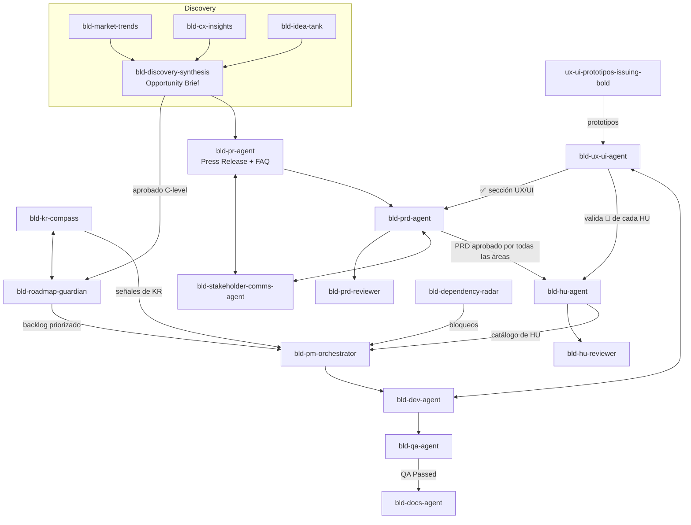

# Conexiones entre agentes BLD

Cómo se pasan el trabajo los agentes de `~/.claude/agents`. Actualizado 2026-10-26.

## Flujo completo

## Tabla de conexiones

| Agente | Recibe de | Entrega a |
|---|---|---|
| bld-market-trends, bld-cx-insights, bld-idea-tank | Consultas del PM | bld-discovery-synthesis |
| bld-discovery-synthesis | Los tres anteriores | bld-roadmap-guardian y bld-pr-agent (tras aprobación C-level) |
| bld-roadmap-guardian | Oportunidades aprobadas, bld-kr-compass | bld-pm-orchestrator |
| bld-kr-compass | ClickUp, bld-roadmap-guardian | bld-roadmap-guardian, bld-pm-orchestrator, bld-prd-agent (KRs) |
| bld-pr-agent | Opportunity Brief | bld-prd-agent (con bld-stakeholder-comms-agent para feedback) |
| bld-prd-agent | PR aprobado, Opportunity Brief | bld-prd-reviewer, bld-stakeholder-comms-agent, bld-hu-agent |
| bld-ux-ui-agent | PRD, HU, prototipos | ✅ de la sección UX/UI, feedback a dev |
| bld-hu-agent | PRD aprobado por todas las áreas | bld-hu-reviewer, bld-pm-orchestrator |
| bld-pm-orchestrator | HU, backlog, KRs, dependencias | bld-dev-agent, bld-qa-agent, bld-docs-agent |
| bld-dependency-radar | ClickUp | bld-pm-orchestrator |
| bld-dev-agent | Tareas del orquestador | bld-qa-agent |
| bld-qa-agent | Trabajo de dev | bld-pm-orchestrator, bld-docs-agent |
| bld-docs-agent | Features con QA Passed | Release notes y documentación |

**Agentes independientes** (no forman parte del pipeline BLD, se usan por separado):
`generador-pr-faq` (PR/FAQ genérico), `prep-campanas-marketing-prod` (campañas de cashback y ROI), `reporte-mastercard-sofia` (reporte semanal Mastercard). `ux-ui-prototipos-issuing-bold` solo se conecta con bld-ux-ui-agent para features de tarjeta débito.

## Cómo se ejecutan las conexiones

Una conexión es un handoff (archivo o comentario en ClickUp). Solo `bld-pm-orchestrator` tiene la herramienta `Agent`, así que es el único que puede invocar a otros agentes por sí mismo. En las etapas de producto (PR, PRD, HU) el handoff lo hace el PM o el hilo principal invocando al siguiente agente. Todos comparten `shared/bld-common.txt` (plantillas, audit trail, evidencia, modelo de dominio y estándares).

## Estándares obligatorios para features de tarjeta débito

Definidos en `shared/bld-common.txt`, sección `[DEBIT_CARD_FEATURE_STANDARDS]`.

1. **Autenticación:** clave dinámica obligatoria (Must). Huella y Face ID deseables (Should); lo ideal es implementar los tres.
2. **Eventos (Segment es la fuente; Braze actúa, Amplitude mide):**
   - Eventos de comunicación: nombre del evento, template (canal, contenido), tabla de roles destinatarios y condiciones. Canales existentes: in-app y push notification. Email, SMS y WhatsApp solo como `[PROPUESTO]`.
   - Eventos informativos: funnel completo de uso del producto o feature, con paso, propiedades y KR.

| Agente | Qué hace con los estándares |
|---|---|
| bld-prd-agent, bld-hu-agent | Los incluyen como requisitos y criterios de aceptación |
| bld-prd-reviewer, bld-hu-reviewer | Marcan como bloqueante si faltan |
| bld-dev-agent | Implementa la autenticación y emite los eventos |
| bld-qa-agent | Validador final: prueba la autenticación, los eventos, los templates y los roles |
