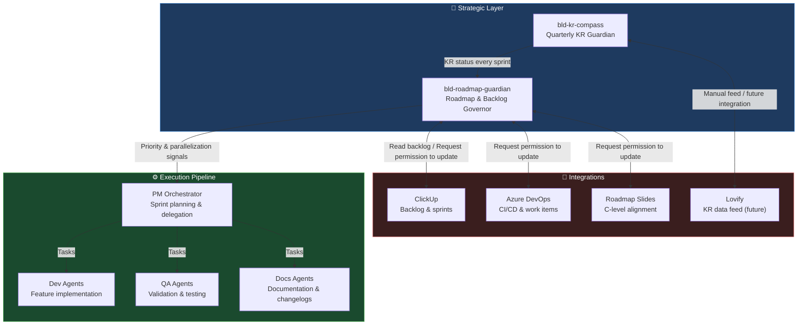
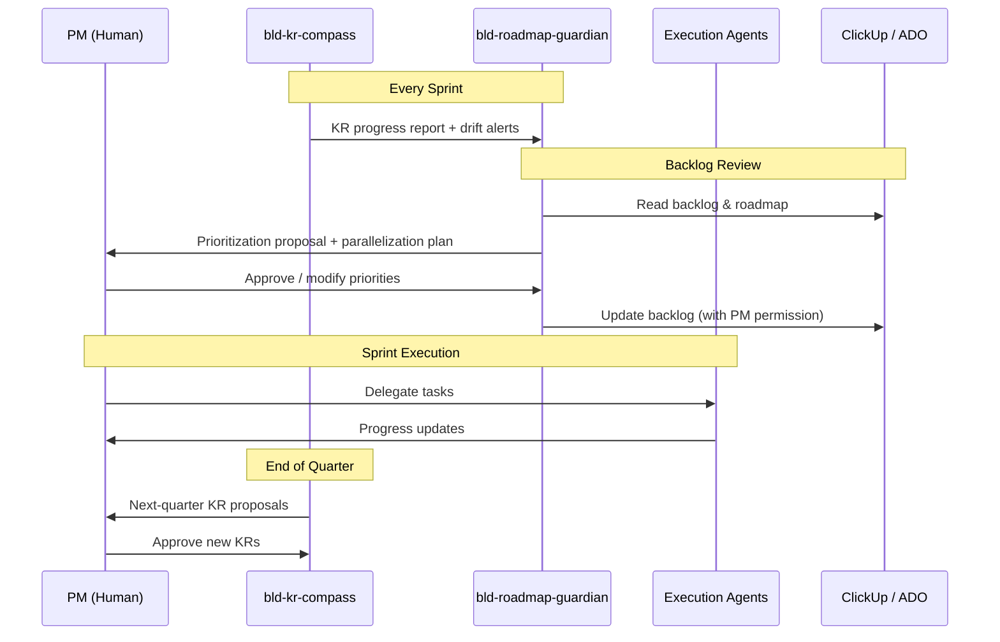
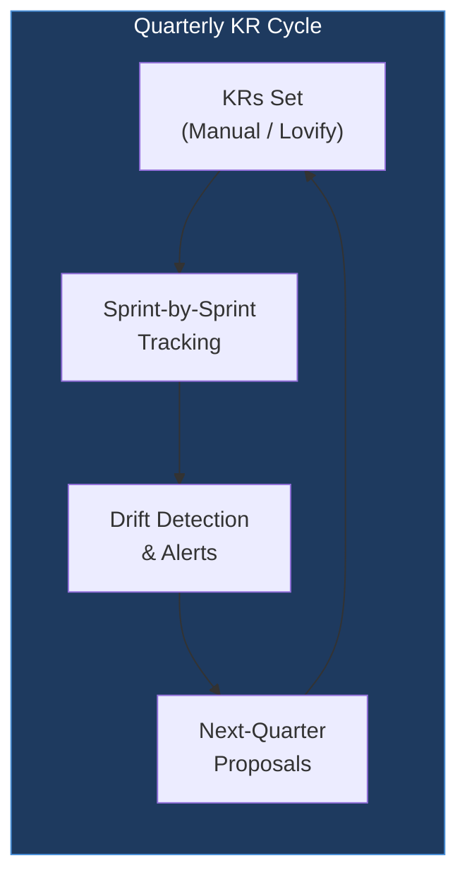
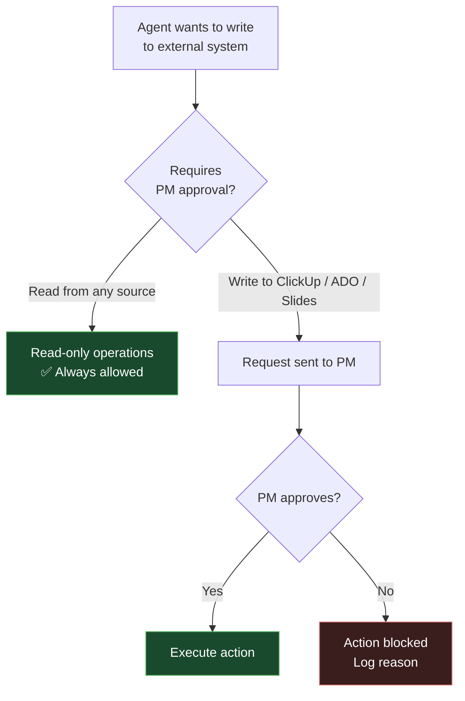

# BLD PM Agents Pipeline

> AI-powered product management pipeline for BLD — strategic planning, roadmap governance, KR tracking, and execution orchestration via Claude Code agents.

---

## Architecture Overview



---

## Agent Descriptions

### 🧭 Strategic Layer

#### `bld-roadmap-guardian`
> Permanent strategic governor of the BLD product roadmap.

- Reads the BLD roadmap from ClickUp and roadmap slides
- Evaluates every feature for **strategic fit**, **priority**, and **parallelization opportunity**
- Monitors backlog health and flags drift
- **Requires explicit PM permission** before writing to ClickUp, Azure DevOps, or roadmap slides
- Receives KR status from `bld-kr-compass` every sprint and uses it as a primary prioritization factor

#### `bld-kr-compass`
> Quarterly KR north star — keeps the team and C-level aligned.

- Holds BLD's quarterly Key Results as the strategic truth
- Tracks KR progress sprint by sprint
- Detects drift early and raises alerts
- Generates next-quarter KR proposals
- KRs fed manually each quarter, or via Lovify when integration is available

---

## Agent Interaction Flow



---

## KR Progress Tracking



---

## Directory Structure

```
~/.claude/
├── agents/              # Agent definition files (.md)
│   ├── bld-roadmap-guardian.md
│   └── bld-kr-compass.md
├── agent-memory/        # Persistent memory across sessions
├── cost-logs/           # Token usage & cost tracking
├── scripts/             # Utility scripts
├── settings.json        # Claude Code configuration
├── .gitignore
└── README.md
```

---

## Permission Model



---

## Setup

```bash
# 1. Clone
git clone git@github.com:juandavidcowboy88/-bld-pipeline.git ~/.claude

# 2. Authenticate GitHub CLI
gh auth login

# 3. Agents are loaded automatically by Claude Code
# Place agent .md files in ~/.claude/agents/
```

---

## Integrations

| System | Access | Auth Method |
|---|---|---|
| ClickUp | Read + Write (PM-gated) | API Token |
| Azure DevOps | Read + Write (PM-gated) | PAT |
| Roadmap Slides | Read + Write (PM-gated) | Google Drive / SharePoint |
| Lovify | Read (future) | API (TBD) |
| GitHub | Read + Write | SSH Key |

---

## Roadmap

- [x] Strategic layer: `bld-roadmap-guardian` + `bld-kr-compass`
- [ ] Execution pipeline agents
- [ ] ClickUp MCP integration
- [ ] Azure DevOps MCP integration
- [ ] Cost tracking dashboard
- [ ] Lovify KR feed integration

---

*Maintained by Juan David Alvarez · BLD Product Team*
