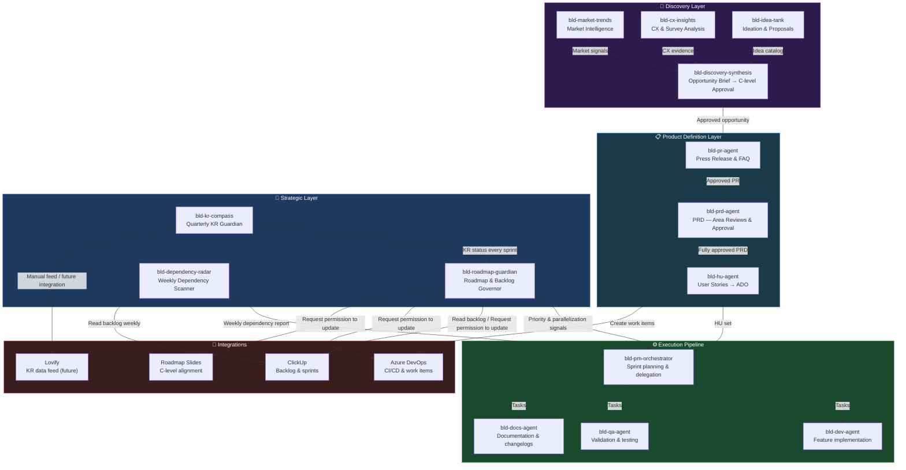
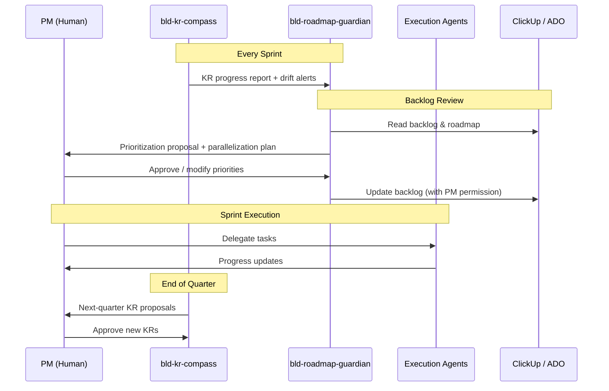
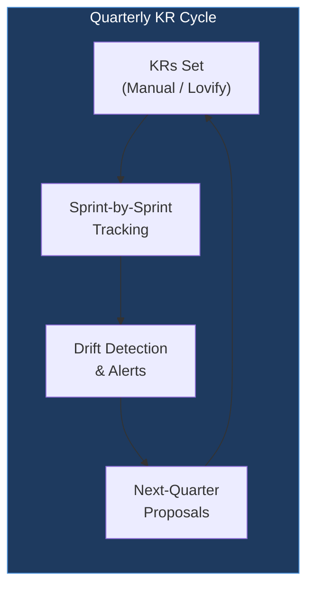
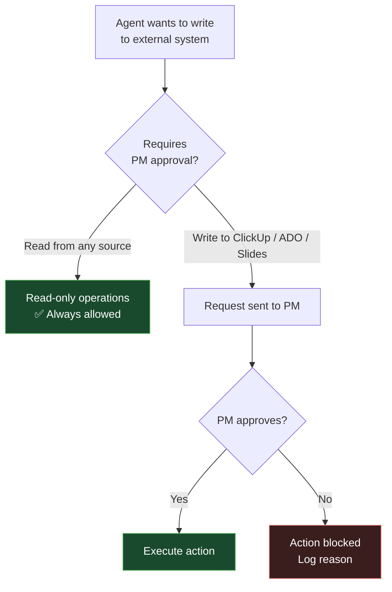

# BLD PM Agents Pipeline

> AI-powered product management pipeline for BLD — strategic planning, roadmap governance, KR tracking, and execution orchestration via Claude Code agents.

---

## Architecture Overview



---

## Agent Descriptions

### 🔭 Discovery Layer

#### `bld-market-trends`
> Scans industry trends, competitor moves, and emerging opportunities.

#### `bld-cx-insights`
> Analyzes customer surveys, NPS, support tickets, and CX channel feedback.

#### `bld-idea-tank`
> Collects and evaluates internal proposals and ideation sessions.

#### `bld-discovery-synthesis`
> Weighs market + CX + ideas into a ranked Opportunity Brief. **C-level approval required** before moving to PR stage.

---

### 📋 Product Definition Layer

#### `bld-pr-agent`
> Amazon-style Press Release and FAQ. Customer-first narrative before any technical work begins. Requires C-level + PM approval to unlock PRD.

#### `bld-prd-agent`
> Full PRD with structured review cycles across all BLD areas: UX/UI, Legal, Finance, Core, FinOps, Backend, Mobile, Web, Operations, Platform, Auth/ID, Lifecycle. **All area heads + C-level must approve** before HU generation is unlocked.

#### `bld-hu-agent`
> Breaks the approved PRD into ADO-format User Stories (Como/Quiero/Para), grouped by epic and area. Hands HU set to bld-pm-orchestrator.

---

### 🧭 Strategic Layer

#### `bld-roadmap-guardian`
> Permanent strategic governor of the BLD product roadmap.

- Reads the BLD roadmap from ClickUp and roadmap slides
- Evaluates every feature for **strategic fit**, **priority**, and **parallelization opportunity**
- Monitors backlog health and flags drift
- **Requires explicit PM permission** before writing to ClickUp, Azure DevOps, or roadmap slides
- Receives KR status from `bld-kr-compass` every sprint and uses it as a primary prioritization factor

#### `bld-dependency-radar`
> Weekly watchdog for blocked tasks and cross-team dependencies.

- Scans the full ClickUp sprint backlog every Monday
- Detects blockers, stalled tasks (>5 days in progress), and unmet DOR
- Produces a structured Dependency Report for PM review
- Drafts stakeholder communication messages for PM to send
- Future: posts directly to a designated Slack channel

---

#### `bld-kr-compass`
> Quarterly KR north star — keeps the team and C-level aligned.

- Holds BLD's quarterly Key Results as the strategic truth
- Tracks KR progress sprint by sprint
- Detects drift early and raises alerts
- Generates next-quarter KR proposals
- KRs fed manually each quarter, or via Lovify when integration is available

---

## Agent Interaction Flow



---

## KR Progress Tracking



---

## Directory Structure

```
~/.claude/
├── agents/              # Agent definition files (.md)
│   │
│   ├── # Discovery Layer
│   ├── bld-market-trends.md
│   ├── bld-cx-insights.md
│   ├── bld-idea-tank.md
│   ├── bld-discovery-synthesis.md
│   │
│   ├── # Product Definition Layer
│   ├── bld-pr-agent.md
│   ├── bld-prd-agent.md
│   ├── bld-hu-agent.md
│   │
│   ├── # Strategic Layer
│   ├── bld-kr-compass.md
│   ├── bld-roadmap-guardian.md
│   ├── bld-dependency-radar.md
│   │
│   ├── # Execution Pipeline
│   ├── bld-pm-orchestrator.md
│   ├── bld-dev-agent.md
│   ├── bld-qa-agent.md
│   └── bld-docs-agent.md
├── agent-memory/        # Persistent memory across sessions
├── cost-logs/           # Token usage & cost tracking
├── scripts/             # Utility scripts
├── settings.json        # Claude Code configuration
├── .gitignore
└── README.md
```

---

## Permission Model



---

## Setup

```bash
# 1. Clone
git clone git@github.com:juandavidcowboy88/-bld-pipeline.git ~/.claude

# 2. Authenticate GitHub CLI
gh auth login

# 3. Agents are loaded automatically by Claude Code
# Place agent .md files in ~/.claude/agents/
```

---

## Integrations

| System | Access | Auth Method |
|---|---|---|
| ClickUp | Read + Write (PM-gated) | API Token |
| Azure DevOps | Read + Write (PM-gated) | PAT |
| Roadmap Slides | Read + Write (PM-gated) | Google Drive / SharePoint |
| Lovify | Read (future) | API (TBD) |
| GitHub | Read + Write | SSH Key |

---

## Roadmap

- [x] Discovery layer: `bld-market-trends`, `bld-cx-insights`, `bld-idea-tank`, `bld-discovery-synthesis`
- [x] Product definition layer: `bld-pr-agent`, `bld-prd-agent`, `bld-hu-agent`
- [x] Strategic layer: `bld-roadmap-guardian`, `bld-kr-compass`, `bld-dependency-radar`
- [x] Execution pipeline: `bld-pm-orchestrator`, `bld-dev-agent`, `bld-qa-agent`, `bld-docs-agent`
- [x] ClickUp task template (Context / Process / DOR / DOD / KR Alignment)
- [x] ADO user story template (Como/Quiero/Para + Reglas + DoR + Técnico + DoD)
- [x] Update audit trail (date, approver, meeting + Google Drive transcript link)
- [ ] ClickUp MCP integration
- [ ] Azure DevOps MCP integration
- [ ] Slack integration for dependency reports
- [ ] Cost tracking dashboard
- [ ] Lovify KR feed integration

---

*Maintained by Juan David Alvarez · BLD Product Team*
