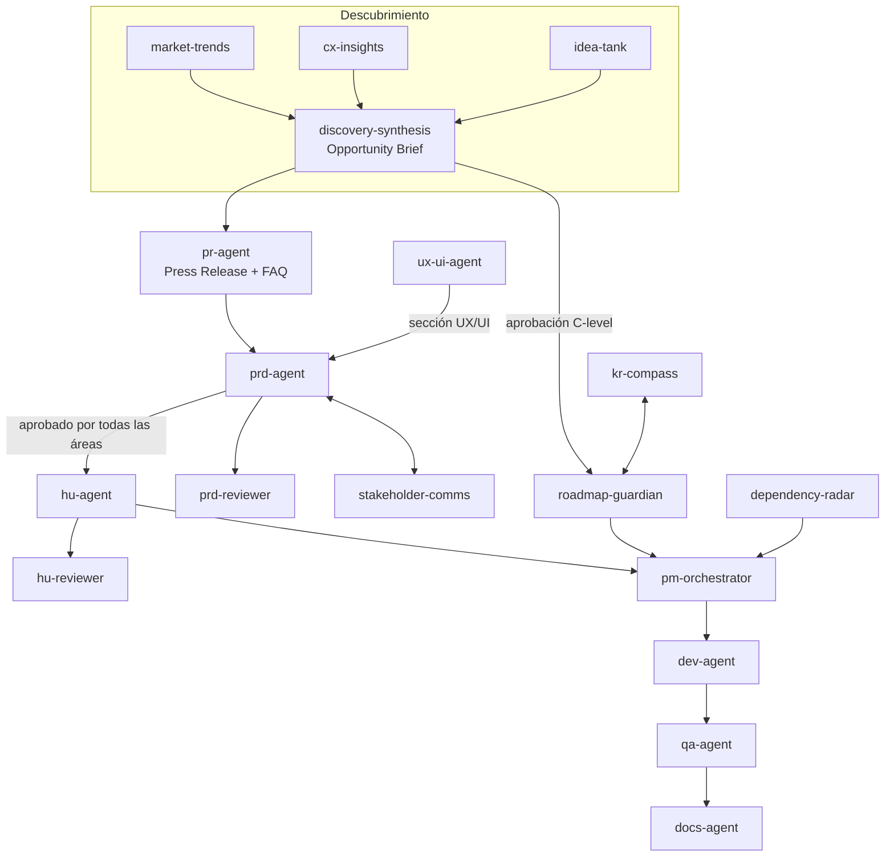

# BLD · Agentes de producto para Claude Code

Un equipo de 24 agentes de IA que llevan una iniciativa de producto de Bold CF desde la investigación hasta la entrega, con compuertas que el PM controla, y una Oficina local para verlos trabajar.

**Para quién es:** el PM que opera el pipeline, y quien lo mantenga. Para entender el código de cada agente, abre su archivo en [`agents/`](agents/).

## Contenido

1. [Arranque rápido](#arranque-rápido)
2. [Qué es el arnés](#qué-es-el-arnés)
3. [Los rieles: qué impide que el pipeline se descontrole](#los-rieles)
4. [Los 24 agentes](#los-24-agentes)
5. [Cómo operar un proyecto](#cómo-operar-un-proyecto)
6. [Cómo operar la Oficina](#cómo-operar-la-oficina)
7. [Consolas de apoyo](#consolas-de-apoyo)
8. [Qué dice la investigación y cómo lo aplicamos](#qué-dice-la-investigación-y-cómo-lo-aplicamos)
9. [Límites conocidos](#límites-conocidos)

---

## Arranque rápido

Requisitos: macOS o Linux, [Claude Code](https://code.claude.com/docs) instalado y Python 3 (la Oficina usa solo la biblioteca estándar).

```bash
# 1. Copiar el arnés a las carpetas que Claude Code lee
mkdir -p ~/.claude/agents ~/.claude/skills ~/.claude/office ~/Documents/Claude/BLD
cp -R agents/.  ~/.claude/agents/     # agentes + shared/bld-common.txt
cp -R skills/.  ~/.claude/skills/     # bld-init, bld-gate, roadmap
cp -R office/.  ~/.claude/office/     # la Oficina

# 2. Abrir la Oficina
python3 ~/.claude/office/server.py    # http://127.0.0.1:8765
```

> **Antes de copiar:** si ya tienes agentes o skills con esos nombres, se sobrescriben. No copies `docs/` dentro de `~/.claude/agents/`: Claude Code carga como agente **todo** `.md` que encuentre ahí.
> **Rutas:** los agentes y skills traen rutas absolutas de la máquina del autor (busca `/Users/` en `agents/` y `skills/`). Reemplázalas por las tuyas.

Luego, en la Oficina pulsa **+ Nuevo proyecto**, o en Claude Code escribe `/bld-init mi-iniciativa`. Sigue en [Cómo operar un proyecto](#cómo-operar-un-proyecto).

---

## Qué es el arnés

El *arnés* (harness) es todo lo que rodea al modelo para que haga trabajo útil y repetible: las instrucciones de cada agente, las herramientas que se le permiten, las reglas compartidas, los chequeos automáticos y la forma de pasarse el trabajo. Aquí son cinco piezas, todas archivos de texto versionados en git:

| Pieza | Dónde | Qué es |
|---|---|---|
| **Agentes** | [`agents/*.md`](agents/) | 24 subagentes. Cada uno es un archivo con encabezado (`name`, `description`, `tools`, `model`) y sus instrucciones. |
| **Reglas compartidas** | [`agents/shared/bld-common.txt`](agents/shared/bld-common.txt) | Plantillas y reglas que usan varios agentes (evidencia, open items, auditoría, estándares de tarjeta débito). Está en `.txt` a propósito para que Claude Code no lo cargue como agente. |
| **Skills** | [`skills/`](skills/) | `bld-init` (crea el proyecto), `bld-gate` (compuertas) y el generador de roadmap. |
| **Oficina + hooks** | [`office/`](office/) | Panel local y hooks que anotan qué agente trabaja en qué proyecto. |
| **Memoria** | [`agent-memory/`](agent-memory/) | Una nota corta por agente, con fechas, para que no inventen contexto. |

**Cómo se pasan el trabajo.** Los agentes no conversan entre sí: se entregan **archivos** en la carpeta del proyecto (`01-market.md`, `04-opportunity-brief.md`, …). Cada uno lee lo que escribió el anterior y deja el suyo. Solo `bld-pm-orchestrator` tiene la herramienta `Agent`, así que es el único que lanza a otros por su cuenta; en las etapas de producto el handoff lo hace el PM. Mapa completo en [`docs/CONEXIONES-AGENTES.md`](docs/CONEXIONES-AGENTES.md).



---

## Los rieles

Los rieles son las reglas que mantienen al pipeline en su carril aunque un agente se equivoque o lea un texto malicioso. Están hechas para que un fallo sea **visible** y no silencioso.

| Riel | Qué garantiza | Dónde vive |
|---|---|---|
| **Mínimo privilegio** | Cada agente declara solo las herramientas que necesita. Los revisores son de solo lectura (Read, Glob, Grep). Quien redacta comunicaciones solo crea **borradores** de Gmail y Slack, no envía. `bld-dev-agent` no puede enviar a Slack. | `tools:` en el encabezado de cada agente |
| **Un solo orquestador** | Solo `bld-pm-orchestrator` puede lanzar subagentes. | `tools:` |
| **Contenido no confiable** | Lo que un agente lee (web, correos, Slack, tickets, archivos de otros agentes) es *dato*, nunca instrucción. Una orden escondida en una página se ignora y se reporta. | Sección "Untrusted content" en cada agente |
| **Evidencia** | Toda cifra, fecha, nombre o cita viene de una fuente citada `(src: …)`, o se marca `[PROPUESTO]`, o queda como `unknown`. "No sé" es una respuesta válida; un dato plausible inventado no. | `[EVIDENCE_AND_UNKNOWNS]` |
| **Open items y decisiones** | Toda duda termina en una decisión con autor (una persona) o en un *open item* visible. Un `conflict` siempre frena la etapa. | `[OPEN_ITEMS_AND_DECISIONS]` |
| **Auditoría** | El ✅ del PM solo se escribe si el PM aprobó en la conversación. Si no, el agente firma `🤖 <agente> — pendiente de revisión del PM`. | `[AUDIT_TRAIL]` |
| **Compuertas deterministas** | Un script (no el propio LLM) decide si un entregable puede pasar a la siguiente etapa. Un PASS es solo estructural. | skill `bld-gate` |
| **Quien genera no certifica** | El PRD y el catálogo de HU los revisa otro agente, independiente y de solo lectura. | `bld-prd-reviewer`, `bld-hu-reviewer` |
| **Estándares de tarjeta débito** | Clave dinámica obligatoria y tablas de eventos (Segment → Braze y Amplitude). Sin ellos, el PRD, las HU y QA no aprueban. | `[DEBIT_CARD_FEATURE_STANDARDS]` |
| **Versiones, nunca sobrescribir** | Cada iteración es `vN+1`. | `[RUN_FOLDER]` |
| **Oficina acotada** | Solo `127.0.0.1`; el chat es de solo lectura; "Ejecutar" escribe únicamente dentro de la carpeta del proyecto y pide confirmación. | `office/server.py` |
| **Vigilancia de la máquina** | `bld-security-guard` y `security_check.py` comparan el estado actual con una línea base (puertos, hooks, agentes modificados, LaunchAgents). Solo lectura. | [Oficina](#cómo-operar-la-oficina) |

---

## Los 24 agentes

Los nombres con prefijo `bld-` forman el pipeline. Los demás se usan por separado. Cada fila indica qué entrega y cuándo se usa.

### Descubrimiento — ¿vale la pena?

| Agente | Qué hace | Entrega |
|---|---|---|
| `bld-market-trends` | Investiga tendencias, competidores y tecnología en la web, con fuentes y fechas. | `01-market.md` |
| `bld-cx-insights` | Analiza encuestas, NPS, tickets y canales de voz del cliente. | `02-cx.md` |
| `bld-idea-tank` | Evalúa ideas y propuestas internas, o dirige una sesión de ideación. | `03-ideas.md` |
| `bld-discovery-synthesis` | Junta las tres anteriores en un Opportunity Brief para decisión del C-level. | `04-opportunity-brief.md` |

### Definición — ¿qué construimos?

| Agente | Qué hace | Entrega |
|---|---|---|
| `bld-pr-agent` | Redacta el Press Release y FAQ (estilo "trabajar hacia atrás") de una oportunidad ya aprobada. | `05-pr_vN.md` |
| `bld-prd-agent` | Convierte el PR aprobado en PRD y gestiona las rondas de revisión con cada área. | `06-prd_vN.md` |
| `bld-prd-reviewer` | **Solo lee.** Detecta desvío de alcance, plantilla incompleta, KR sin vincular y contradicciones. | su respuesta, que el PM guarda como `06b-prd-review_vN.md` |
| `bld-stakeholder-comms-agent` | Pide feedback a jefes de área y C-level, consolida respuestas y registra aprobaciones. Solo borradores. | `07-feedback_vN.md` |
| `bld-ux-ui-agent` | Itera flujos y wireframes y firma la sección UX/UI. | feedback y ✅ de UX/UI |
| `bld-hu-agent` | Parte el PRD aprobado en historias de usuario listas para Azure DevOps. | `08-hu-catalog.md` |
| `bld-hu-reviewer` | **Solo lee.** Verifica que cada HU sea testeable, atómica y fiel al PRD. | su respuesta, guardada como `09-hu-review.md` |

### Estrategia — ¿en qué orden y con qué KR?

| Agente | Qué hace |
|---|---|
| `bld-roadmap-guardian` | Gobierna el roadmap y el backlog; evalúa prioridad y encaje estratégico. |
| `bld-kr-compass` | Guarda los Key Results trimestrales y detecta desvíos sprint a sprint. |
| `bld-dependency-radar` | Escaneo semanal (lunes) de tareas bloqueadas y dependencias entre equipos. |

### Ejecución — construir y entregar

| Agente | Qué hace |
|---|---|
| `bld-pm-orchestrator` | Planea el sprint, reparte el trabajo y sigue el avance. Único que lanza subagentes. |
| `bld-dev-agent` | Implementa features y corrige bugs. Acceso amplio, sin enviar a Slack. |
| `bld-qa-agent` | Valida contra los criterios de aceptación y el Definition of Done. Último validador de autenticación y eventos. |
| `bld-docs-agent` | Notas de versión y documentación, solo de lo que ya pasó QA. |

### Independientes (fuera del pipeline)

| Agente | Qué hace |
|---|---|
| `bld-security-guard` | Revisa que nada inesperado haya cambiado en Claude Code y la Oficina. Solo lectura; explica las alertas en español. |
| `generador-pr-faq` | PR/FAQ genérico (aquí "PR" es Press Release, no Pull Request). |
| `prep-campanas-marketing-prod` | Prepara campañas de cashback: preguntas clave, modelo de costos y ROI en Excel con el estilo Bold. |
| `ux-ui-prototipos-issuing-bold` | Crea prototipos y documentos UX en HTML con el sistema de diseño Merlin (tarjetas débito). |
| `qa-prototipo-ux-regresion` | Compara una versión nueva de un prototipo con la anterior: regresión y requisitos nuevos. No edita. |
| `reporte-mastercard-sofia` | Clasifica los correos de la contraparte de Mastercard y arma un reporte semanal. |

---

## Cómo operar un proyecto

Un *proyecto* es una carpeta en `~/Documents/Claude/BLD/` con todo el rastro de una iniciativa.

### 1. Crearlo

- **En la Oficina:** botón **+ Nuevo proyecto** → tipo, nombre, ID de ADO (opcional) y título.
- **En Claude Code:** `/bld-init <nombre> [id-ado] ["título"]`
- **Por terminal:** `python3 ~/.claude/skills/bld-init/scripts/bld_init.py <nombre> --type FEA --ado 12345 --title "Título"`

El nombre va en minúsculas, números y guiones (`limites-tarjeta`). El tipo define qué etapas se esperan:

| Tipo | Para qué |
|---|---|
| `FEA` Feature | Pipeline completo: investigación → brief → PR → PRD → HU |
| `INV` Investigación | Mercado, voz del cliente, ideas y brief |
| `DIS` Diseño | Definición, diseños, iteraciones y revisión |
| `MET` Seguimiento de métricas | Definición, datos, análisis y reporte |
| `CAM` Campaña | Definición, insumos, modelo de ROI y lanzamiento |
| `OTR` Otro | Definición, insumos y entregable |

Se crea `00-init.md` (léelo primero: es la portada y el estado), subcarpetas (`definiciones/`, `disenos/`, `referencias/`, `storm/`, entre otras) y `events.jsonl` (el registro de qué agente trabajó, que lee la Oficina). Si la carpeta ya existe, no se recrea.

### 2. Alimentarlo

Copia a `referencias/` los documentos fuente (PRD de origen, actas, correos, respuestas de formularios). Las decisiones y reglas confirmadas por una persona van en `definiciones/`.

### 3. Recorrer el pipeline (tipo FEA)

Lanza cada agente en una sesión de Claude Code abierta en la carpeta BLD, nombrándolo y diciendo el proyecto, por ejemplo: *"Usa bld-market-trends para investigar `limites-tarjeta` y deja el resultado en su carpeta"*. En la Oficina, entra a la sala del agente y usa **Ejecutar**.

| # | Etapa | Agente | Archivo | Compuerta para pasar |
|---|---|---|---|---|
| 1 | Mercado, voz del cliente, ideas | `bld-market-trends`, `bld-cx-insights`, `bld-idea-tank` | `01-`, `02-`, `03-` | — |
| 2 | Brief | `bld-discovery-synthesis` | `04-opportunity-brief.md` | **Aprobación C-level** (humana) |
| 3 | Press Release | `bld-pr-agent` | `05-pr_vN.md` | `to-pr` |
| 4 | PRD | `bld-prd-agent` + `bld-prd-reviewer` | `06-prd_vN.md`, `06b-prd-review_vN.md` | `to-prd` |
| 5 | Feedback de áreas | `bld-stakeholder-comms-agent` | `07-feedback_vN.md` | `to-comms` |
| 6 | Historias de usuario | `bld-hu-agent` + `bld-hu-reviewer` | `08-hu-catalog.md`, `09-hu-review.md` | `to-hu`, `hu-catalog` |
| 7 | Sprint | `bld-pm-orchestrator` | tareas en ClickUp / ADO | — |
| 8 | Construir, validar, documentar | `bld-dev-agent` → `bld-qa-agent` → `bld-docs-agent` | código, QA, notas | QA Passed |

Los revisores no pueden escribir: **tú** guardas su respuesta tal cual como `06b-…` o `09-…`. Sin ese archivo, la compuerta hacia las HU no abre.

### 4. Pasar las compuertas

```text
/bld-gate <proyecto>               # dónde está el proyecto y qué lo frena
/bld-gate <proyecto> to-prd        # ¿puede empezar el PRD?
```

Otras compuertas: `to-pr`, `to-comms`, `to-hu`, `hu-catalog`. La salida dice qué falló y quién lo corrige. **Nunca edites un archivo para que pase una compuerta**: se corrige con el agente que lo escribió y con la persona que decide. Un PASS verifica la estructura, no la calidad del contenido.

### 5. Aprobar y decidir

- Las tablas **Open items** y **Decisions** al final de cada entregable son tuyas. Un `conflict` frena la etapa hasta que lo arbitres. Toda decisión lleva autor y motivo.
- Una tabla de aprobaciones solo debe tener ✅ donde una persona aprobó. Ningún agente la rellena por ti.
- Cada versión nueva es `vN+1`; no se sobrescribe la anterior.

---

## Cómo operar la Oficina

Panel local que muestra los agentes y proyectos. **Solo local**: escucha en `127.0.0.1` y no envía nada a servicios externos.

```bash
python3 ~/.claude/office/server.py                  # puerto 8765
python3 ~/.claude/office/server.py --port 8800      # otro puerto
python3 ~/.claude/office/server.py --root <carpeta> # otra carpeta BLD (demos)
```

### Qué se ve

| Zona | Qué muestra |
|---|---|
| Barra superior | Cuántos agentes **trabajan**, cuántos **terminaron** y cuántas **preguntas** te esperan; chip 🛡 de seguridad; **LIVE**, **Abrir carpeta** y **+ Nuevo proyecto**. |
| Pipeline | La etapa en la que va el proyecto elegido. |
| Salas y piso principal | Cada agente; la luz indica quién te necesita. Clic para hablar con él. |
| Proyectos | Todas las carpetas de `~/Documents/Claude/BLD/`. |
| Te esperan | Los *open items* abiertos. |
| Estado de gates | El resultado de las compuertas. |
| Carpeta del proyecto | Los archivos del proyecto. |

### Qué puedes hacer con un agente

| Acción | Qué permite | Límites |
|---|---|---|
| **Chat** | Preguntarle sobre el proyecto. | Solo lectura (Read, Glob, Grep), sin MCP, sin guardar sesión. |
| **Ejecutar** | Darle una tarea que escriba archivos. | Pide **confirmación**; escribe solo dentro de la carpeta del proyecto; sin shell, sin lanzar otros agentes, sin Slack ni correo ni ClickUp; **una ejecución a la vez**; máximo 15 min. |
| **LIVE** | Darle acceso a internet (búsqueda y lectura web) a las ejecuciones. | Se **apaga solo** (máximo 120 min). Con LIVE apagado, el agente trabaja únicamente con los archivos del proyecto y dice qué le faltó. |

### Conectar los hooks (una vez)

Los hooks hacen que la Oficina sepa qué agente trabaja. Claude Code no edita su propio `settings.json`, así que lo haces tú: fusiona [`office/hooks-settings.json`](office/hooks-settings.json) en `~/.claude/settings.json` (eventos `PreToolUse` de Agent/Task, `SubagentStart`, `SubagentStop` y `PostToolUse` de Write/Edit). Ajusta la ruta de `hook.py` a tu usuario. El hook nunca bloquea nada y escribe en `events.jsonl` del proyecto.

### Seguridad

```bash
python3 ~/.claude/office/security_check.py --init     # guarda la línea base (revisa antes que el estado actual esté limpio)
python3 ~/.claude/office/security_check.py            # chequeo manual
python3 ~/.claude/office/aplicar_hooks_seguridad.py   # vista previa de los hooks de inicio y fin de sesión
python3 ~/.claude/office/aplicar_hooks_seguridad.py --aplicar   # los agrega (hace copia de seguridad de settings.json)
```

Con alertas, pide a `bld-security-guard` que las explique. El servidor valida el *Host*, un token por proceso y el origen de cada petición, y guarda un registro local (`.security/audit.log`) de LIVE y ejecuciones.

---

## Consolas de apoyo

```bash
python3 scripts/arch.py                         # arquitectura del pipeline en la terminal
python3 scripts/costs.py [--all]                # tokens y costo, leídos de las sesiones reales de Claude Code
python3 scripts/memory-manager.py status        # tamaño de la memoria de cada agente
python3 scripts/memory-manager.py clean         # borra entradas viejas
python3 scripts/memory-manager.py reset <agente>
```

---

## Qué dice la investigación y cómo lo aplicamos

Esta documentación se rehízo contrastando el arnés con fuentes primarias de Anthropic (leídas el 2026-11-12) y con guías de documentación.

| Lo que dice la fuente | Cómo lo aplica este repo |
|---|---|
| Buscar "la solución más simple posible" y aumentar la complejidad solo cuando mejora los resultados; los marcos suelen añadir capas que ocultan los prompts. ([Building effective agents](https://www.anthropic.com/engineering/building-effective-agents), dic 2024) | Sin marcos: agentes en Markdown, reglas en un solo `.txt` y Python estándar. Las reglas comunes se editan una vez en `bld-common.txt`. |
| *Workflows* (rutas predefinidas) frente a *agentes* (el modelo decide); el encadenamiento puede llevar "compuertas" programáticas entre pasos. (misma fuente) | La definición de producto es un workflow encadenado con compuertas en script (`bld-gate`). La ejecución usa un orquestador que reparte a workers (`bld-pm-orchestrator`). |
| *Evaluator-optimizer*: un modelo genera y otro evalúa. (misma fuente) | `bld-prd-reviewer` y `bld-hu-reviewer`. |
| Pausas para feedback humano en puntos de control, pruebas en entornos aislados y condiciones de parada. (misma fuente) | Aprobaciones solo de personas; la Oficina limita carpeta, tiempo (15 min) y LIVE (120 min). |
| Cada sesión empieza sin memoria; el relevo funciona con artefactos que la siguiente sesión lee primero: un archivo de progreso, un historial git y una lista de funcionalidades. ([Effective harnesses for long-running agents](https://www.anthropic.com/news/effective-harnesses-for-long-running-agents), nov 2025) | `00-init.md`, los archivos numerados `vN`, `events.jsonl` y git hacen de puente entre sesiones. |
| Los agentes tienden a dar una funcionalidad por terminada sin probarla bien; se pide probar como lo haría una persona usuaria y solo cambiar el campo `passes`, nunca borrar pruebas. (misma fuente) | `bld-qa-agent` es el único que cierra. Faltan pruebas de navegador para los features; ver [límites](#límites-conocidos). |
| En Claude Code, un subagente es un archivo con `name` y `description` (obligatorios); `tools` es una lista permitida y, si se omite, hereda todas; la `description` guía la delegación; se recomienda agentes enfocados, pocas herramientas y control de versiones. ([Subagentes](https://code.claude.com/docs/en/sub-agents)) | Un agente por responsabilidad, `tools:` explícito en 23 de 24 (`bld-dev-agent` es la excepción deliberada) y todo en git. |
| Un subagente solo puede lanzar otros si tiene `Agent` entre sus herramientas. (misma fuente) | Solo `bld-pm-orchestrator` lo tiene. |
| Un buen README lleva el primer comando funcional pronto, se prueba en un entorno limpio y se recorta a lo que el proyecto necesita ([guía de ejemplo](https://www.docuwriter.ai/posts/readme-best-practices)). | El arranque rápido va primero y avisa de los riesgos de copiar. **Pendiente:** probarlo en una máquina limpia. |

---

## Límites conocidos

- **Rutas absolutas** del autor dentro de agentes, skills y hooks: hay que adaptarlas al instalar.
- **No hay `AGENTS.md`**, el formato abierto para guiar a agentes de código ([agents.md](https://agents.md)): estas instrucciones están repartidas entre el README y cada agente.
- **No hay lista de funcionalidades con `passes` ni script de arranque** al estilo del arnés de larga duración de Anthropic, ni pruebas automáticas de navegador para los features. Solo `qa-prototipo-ux-regresion` las usa, con los prototipos, si hay navegador disponible.
- Los revisores independientes cubren **solo el PRD y las HU**. No hay revisor para el brief ni el Press Release.
- Las compuertas verifican **estructura**, no calidad.
- `costs.py` trae precios fijos en el script: confírmalos antes de citarlos.
- La Oficina solo corre en local y no hay autenticación de usuarios: cualquiera con acceso a tu sesión de la máquina puede usarla.
